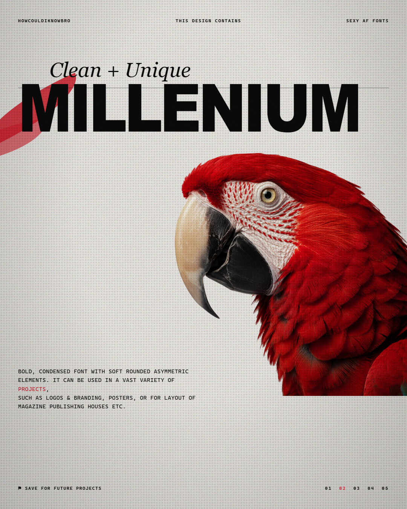

# The Design Ecosystem — Architecture

How FlowDesk Studio becomes a conversational design tool that produces
reference-quality graphic design, app UI, and web UI — with the agent in
control of composition, texture, effects, and typography, and every result
still editable by hand.

Builds on and supersedes the open questions in
[2026-09-01-design-ecosystem-research.md](2026-09-01-design-ecosystem-research.md).

Everything below is grounded in one of two things: a sourced research finding,
or a test actually run inside FlowDesk on 2026-09-01. Where something is
neither, it says so.

---

## The result that decides the question

The thesis — *can HTML/CSS reach the quality of the reference set?* — was
tested end to end, not argued about.



That poster was produced entirely inside FlowDesk: the macaw was generated
through the real `ask_chatgpt` worker path (94 seconds), the composition is
plain HTML and CSS, and the image is the actual PNG our export path wrote. No
Photoshop, no external tooling.

Every technique the reference set depends on is present and working:

| Technique from the references | Status in the test |
| --- | --- |
| Display type running **behind** the subject | Works — this was the highest-risk item |
| Halftone dot texture over the whole sheet | Works, pure CSS |
| Film/paper grain | Works, SVG `feTurbulence` |
| Strict three-colour palette | Works, enforced by tokens |
| Two-role typography (display + mono body) | Works |
| Editorial grid with micro-labels and pagers | Works, 12-column CSS grid |

The gap that remains is **typeface**, not capability: the references use
condensed grotesques we have not bundled, so the display line is an
approximation. That is a licensing-and-packaging task, not an architectural
one.

**Conclusion: the architecture is sound. Build it.**

---

## What the tests actually established

Six findings, all from real runs. Four of them are things that would have
silently broken the system later.

### 1. Effects survive export — WebGL does not

A six-band artboard was exported through the real `studio:exportPng` path:

| Technique | In the exported PNG |
| --- | --- |
| SVG `feTurbulence` grain | **Works** |
| CSS halftone (`radial-gradient` + `blur` + `contrast`) | **Works** |
| `mix-blend-mode` | **Works** |
| `backdrop-filter: blur` | **Works** |
| Live WebGL canvas | **Renders black** |
| WebGL baked via `toDataURL()` | **Works** |

In-page instrumentation reported `webgl: DREW, readPixels=[1,251,166]` — WebGL
genuinely renders on the canvas; only the offscreen export loses it.

**Consequence:** Paper Shaders (Apache 2.0, npm, zero dependencies, containing
Halftone Dots, Halftone CMYK, Paper texture, Grain Gradient — the exact effects
in the reference set) is usable, but **only as an authoring surface**. Every
shader must be baked to a raster before export. That bake is proven to work,
inside our existing sandboxed iframe, with no change to the export path.

### 2. Images must use `studio-asset://`, never relative paths

The export renders from `data:text/html;charset=utf-8,…`
(`electron/studio/render.ts:76`). A `data:` URL has no base, so
`src="assets/parrot.png"` cannot resolve — the first export came back with a
broken-image icon where the subject should have been.

`studio-asset://<documentId>/<fileName>` works, because the protocol is
registered with `standard: true` and resolves independent of any base.

**This is a hard rule for every generated document.** It is invisible on the
canvas (where relative paths *do* resolve) and only fails at export, which is
the worst possible time to discover it.

### 3. An `<svg>` sized only by CSS silently truncates its filter

Grain initially covered a 300×150 patch instead of the full band. Not an export
failure: an `<svg>` with `position:absolute; inset:0` still has the **default
300×150 viewport**, so the filter fills the viewport, not the element. Explicit
`width`/`height` attributes fixed it completely.

Any generated SVG-filter effect must carry real dimension attributes.

### 4. `mix-blend-mode` is not a substitute for an alpha channel

The tempting shortcut — generate the subject on white, use
`mix-blend-mode: multiply` to drop the white out — **does not work reliably**.
Two independent reasons, both found by testing:

- Generated "pure white" is not pure. The macaw's corners measured `[253,253,253]` and `[255,255,255]` — a real gradient across what was prompted as flat white.
- Wrapping the image in a `z-index`ed plane creates a stacking context, and `mix-blend-mode` blends only with its own stacking context's backdrop. The wrapper made the image blend against transparency instead of the artboard.

Replacing it with a **real alpha channel** fixed the composition immediately.

**Consequence:** the ONNX cutout is not optional and not deferrable — it is
load-bearing for the single most distinctive effect in the reference set. The
research already established it runs locally.

### 5. The image pipeline works end to end, and takes ~90 seconds

Generate through `ask_chatgpt` → save → cut out → place → compose → export.
94 seconds for the generation, everything else effectively instant.

### 6. Layering is a property, not luck

Declaring explicit planes (`back` / `type` / `subject` / `fore` / `texture`)
and assigning every element to one is what made "put the type behind the
subject" a thing the agent can *state* rather than a thing it has to achieve by
getting DOM order right. This is the single highest-leverage structural idea in
the test file.

---

## Why AI design looks average, and the fix

The most important research finding is not about textures at all:

> When an agent cannot find a rule, it invents one — if it does not understand
> typography hierarchy, it improvises, and if it does not know the spacing
> grammar, it distributes elements generically.
> — [Design Systems for AI agents](https://medium.com/@vicentegrafico.com/design-systems-for-ai-agents-the-new-paradigm-shift-ad097cfae228)

That is the whole explanation for "AI designs look average." The agent is not
short of talent; it is short of **rules**, so it improvises, and improvisation
averages out.

This is corroborated quantitatively: giving a model free-form reasoning
followed by **structured output under constraints** raised accuracy from
**48% to 61%** ([Guiding LLMs The Right Way](https://arxiv.org/html/2403.06988v1),
[UI Layout Generation with LLMs Guided by UI Grammar](https://arxiv.org/pdf/2310.15455)).
Approaches where the AI **selects from registered components** outperform those
where it emits raw HTML/CSS freely.

So the path to "95% accurate first shot" is not a better prompt. It is
**removing the agent's freedom to improvise the things it improvises badly**,
while keeping its freedom where it is genuinely strong (concept, copy,
composition intent).

### The three rules, and why each one works

From the carousel video, and each independently supported by the design
literature:

**Three colours with fixed roles** — `--bg`, `--ink`, `--accent`. Not "a
palette"; three slots with jobs. An agent that wants a fourth colour has
nowhere to put it.

**Two fonts with fixed roles** — display carries all the personality, body
carries none. Encoded as **composite tokens**, following the pattern
[layout.md](https://layout.design/docs/layout-md) arrived at independently:

```css
--type-display: 800 176px/0.84 <face>;
--type-body:    400 15px/1.55 <face>;
```

Bundling family + size + weight + leading + tracking into one token per *role*
is what structurally prevents the agent from mixing scales. Hand it
`font-family` and `font-size` as separate knobs and it will eventually combine
them into something no designer would.

**A layout template decided once** — margins, columns, flowlines, and a
typographic scale (a 1.25 major-third gives caption → body → subhead → headline
→ display from one ratio), all snapped to an 8pt spacing grid so vertical
rhythm survives size changes
([typography grid systems](https://gridmakerpro.com/grids/typography-grids/)).

To which the research adds a fourth, from layout.md's Section 9:

**NEVER rules** — explicit forbidden patterns. "Never more than one display
face per artboard." "Never place body copy below 14px." "Never introduce a
colour outside the three tokens." Forbidding is cheaper and more reliable than
describing.

---

## Architecture

Five layers. Each one exists because a test or a source said it has to.

```
┌─ Design intelligence ── tokens, grid, scale, NEVER rules
│                         the agent designs WITHIN this, not around it
├─ Agent tool surface ─── per-element read/write  ← the current blocker
├─ Effects vocabulary ─── named, parameterised, export-safe
├─ Asset pipeline ─────── generate → cut out → place
└─ Canvas + export ────── HTML is truth; artboards at natural size  ✅ built
```

### Layer 1 — Agent tool surface (the actual blocker)

Paper's MCP exposes 21 tools; ours exposes 10, and the missing capability is
concentrated in one place: **there is no way for the agent to read or write the
style of a single element.** `studio_update_styles` rewrites the document's
`:root` block, and nothing reads computed style at all.

Everything conversational depends on closing this. *"Make this effect
stronger"* is a read-modify-write loop:

1. `studio_get_computed_styles(elementId)` — what is it **now**
2. reason about the delta
3. `studio_update_styles(elementId, { … })` — write **that element**

Without step 1 the agent is guessing what "stronger" is relative to. Without
step 3 it cannot act on one element at all.

The `data-fd-el` ids this needs **already exist and already persist** — that
shipped in Phase 2 and was confirmed working during these tests. And because
user edits land as inline styles (which outrank the stylesheet), agent writes
and hand edits land in exactly the same place, so neither silently loses to the
other.

Minimum set to add, mirroring Paper's proven surface:

| Tool | Why |
| --- | --- |
| `studio_get_computed_styles` | the read half of every adjustment |
| `studio_update_styles` *(per-element)* | the write half |
| `studio_get_tree_summary` | lets the agent see structure without pulling whole HTML into context |
| `studio_set_text_content` | change words without rewriting markup |
| `studio_get_selection` | act on what the user is pointing at |
| `studio_move_nodes` / `studio_delete_nodes` | structural edits that preserve ids |

### Layer 2 — Effects vocabulary

Not "the agent writes CSS." A **named, parameterised catalogue** —
`grain`, `halftone`, `paper`, `duotone`, `vignette`, `glow`, `dither` — each
with a documented parameter range, each implemented in a technique the export
test validated.

Three reasons this beats free-form CSS, all evidenced above:

- **Constrained selection outperforms free generation** (the 48%→61% finding).
- It gives the agent something to *brainstorm over*. "What else could work here" is answerable against a catalogue; against arbitrary CSS it is improvisation, which is the failure mode.
- It is where the export-safety rules live. The `<svg>` dimension rule and the stacking-context rule get encoded **once**, in the effect, instead of being rediscovered every time the agent writes a filter by hand.

Implementation is technique-per-effect, not one-size-fits-all: CSS/SVG where it
suffices (grain, halftone, vignette, duotone), Paper Shaders where the GPU
genuinely wins (liquid metal, mesh gradients, dithering) — with the bake step
on export.

**This is the piece with no off-the-shelf answer, and therefore the one worth
building ourselves.** Paper Shaders is a shader library, not a design
vocabulary; layout.md is a token spec, not an effects system. A named,
agent-addressable, export-safe effects vocabulary over an HTML canvas does not
appear to exist. If any part of this project is novel, it is this.

### Layer 3 — Asset pipeline

`ask_chatgpt` → generated PNG → **ONNX cutout** → `studio-asset://` → placed on
a declared plane.

Model choice is a real tradeoff, measured:

| Model | Size | Hair accuracy | Speed |
| --- | --- | --- | --- |
| U²-Net | 176 MB | 71% | 307 ms |
| ISNet | 179 MB | 81% | 351 ms |
| BiRefNet | 973 MB | 94% | 821 ms |

([BiRefNet vs rembg vs U2Net](https://dev.to/om_prakash_3311f8a4576605/birefnet-vs-rembg-vs-u2net-which-background-removal-model-actually-works-in-production-4830))

Hair quality is exactly what the "figure walking through the letterforms"
composition depends on, which argues for BiRefNet — but a ~1 GB model has no
business in an installer. **Recommendation: ship with ISNet, fetch BiRefNet on
first use and cache it.** Local-first is preserved; the download happens once
and only if the user reaches for that feature.

### Layer 4 — Design intelligence

The tokens, grid, scale, and NEVER rules above, expressed as a machine-readable
document the agent queries — the layout.md pattern, adapted. Two consequences
worth stating:

- The agent reads its constraints instead of being told them in a prompt, so they survive context compaction.
- The same document is what a *user* edits to change the whole look, which is how "change the theme" becomes one edit rather than a rewrite.

### Layer 5 — Canvas and export ✅ already built

Artboards at natural size, pan/zoom, click-to-select, persisted per-element
ids, undo/redo, PNG/PDF export. Shipped and merged.

---

## App UI and website design

The same engine, different numbers — the point the original Studio spec already
made, now with the effects layer on top:

| Output | Artboards |
| --- | --- |
| Instagram carousel | 8 × 1080×1350 |
| YouTube thumbnail | 1 × 1280×720 |
| Mobile app flow | 5 × 390×844 |
| Web page | 1 × 1440×3000 |

The design-intelligence layer changes shape rather than disappearing: for app
and web work the tokens become a real design system (8pt spacing, semantic
colour roles, a type scale) and the NEVER rules become platform rules — iOS
tap targets ≥44pt, Material spacing, contrast minimums.

One honest caveat carried from the research: Paper's own generated code uses
absolute positioning and is **not responsive**, and reviewers flag this as its
main production limitation. Our artboards have the same property. Fixed-size
artboards are correct for posters and thumbnails; for shipping web UI, a
responsive story is a genuine open problem, and it is not solved by anything in
this document.

---

## Build order

Each step is unblocked by the one before it, and step 1 is unblocked today.

1. **Per-element style read/write** — the whole conversational loop depends on it, and nothing else can be built convincingly first.
2. **Effects vocabulary v1** — grain, halftone, paper, vignette, duotone. Pure CSS/SVG, all export-validated. Encode the `<svg>`-dimension and stacking-context rules inside the effects.
3. **Design-intelligence document** — tokens, grid, scale, NEVER rules, plus the tool that queries it.
4. **ONNX cutout** — ISNet bundled, BiRefNet on demand. Unlocks subject-behind-type and background removal together.
5. **Paper Shaders + bake-on-export** — the GPU effects, once the CSS vocabulary has proven the shape of the system.
6. **Typography** — licence and bundle OFL display faces. This is what closes the last visible gap between our recreation and the references.
7. **Vector/SVG editing** — last, matching Paper's own ordering; it is still roadmap for them.

---

## Still unverified

| Claim | Status | Cheapest experiment |
| --- | --- | --- |
| ONNX cutout quality on real subjects, and packaged size | **Unverified.** The test used a hand-written chroma-key, not a model; it left a visible artifact where the subject met the frame edge. | Run one reference photo through ISNet and BiRefNet; measure edge quality on hair and package size |
| Paper Shaders renders correctly inside our sandboxed iframe | **Unverified.** Raw WebGL does (tested); the library adds React/npm packaging on top. | `npm i @paper-design/shaders-react`, drop one Grain Gradient into a test artboard, export |
| Which OFL faces actually match the references | **Not researched.** Licensing is settled — OFL permits bundling in commercial Electron apps with attribution. The *selection* is not. | An afternoon with the reference set and Google Fonts' condensed grotesques |
| Whether constrained effects genuinely raise first-shot accuracy for *us* | **Inference** from published results on UI generation, not measured on this system. | Once the vocabulary exists: same brief, ten runs with and without it, count usable outputs |
| Responsive output for app/web work | **Open problem.** Not solved here, and not solved by Paper either. | Its own research pass before any web-UI push |

---

## Sources

- [paper.design](https://paper.design/) · [MCP tools](https://paper.design/docs/mcp) · [vector editing](https://paper.design/docs/svg)
- [Paper Shaders](https://shaders.paper.design/) · [GitHub, Apache 2.0](https://github.com/paper-design/shaders)
- [Electron offscreen rendering](https://www.electronjs.org/docs/latest/tutorial/offscreen-rendering) · [electron#39859](https://github.com/electron/electron/issues/39859)
- [WebGL Fundamentals — canvas screenshots](https://webglfundamentals.org/webgl/lessons/webgl-tips.html)
- [Codrops — feTurbulence texture](https://tympanus.net/codrops/2019/02/19/svg-filter-effects-creating-texture-with-feturbulence/) · [freeCodeCamp — grainy backgrounds](https://www.freecodecamp.org/news/grainy-css-backgrounds-using-svg-filters/)
- [Lean Rada — CSS halftone](https://leanrada.com/notes/pure-css-halftone/) · [Frontend Masters — halftone in 3 declarations](https://frontendmasters.com/blog/pure-css-halftone-effect-in-3-declarations/)
- [web.dev — CSS masking](https://web.dev/articles/css-masking) · [CSS-Tricks — knockout text](https://css-tricks.com/css-techniques-and-effects-for-knockout-text/)
- [BiRefNet vs rembg vs U2Net](https://dev.to/om_prakash_3311f8a4576605/birefnet-vs-rembg-vs-u2net-which-background-removal-model-actually-works-in-production-4830) · [BaepatLabs/background-remover](https://github.com/BaepatLabs/background-remover/blob/main/SKILL.md)
- [layout.md](https://layout.design/docs/layout-md) · [Design Systems for AI agents](https://medium.com/@vicentegrafico.com/design-systems-for-ai-agents-the-new-paradigm-shift-ad097cfae228)
- [Guiding LLMs The Right Way](https://arxiv.org/html/2403.06988v1) · [UI Layout Generation with LLMs Guided by UI Grammar](https://arxiv.org/pdf/2310.15455)
- [Typography grid systems](https://gridmakerpro.com/grids/typography-grids/) · [Editorial poster grids](https://gridmakerpro.com/grids/design-templates/poster-editorial/)
- [SIL OFL — bundling](https://openfontlicense.org/ofl-fonts/) · [CSS Paint API / Houdini](https://developer.chrome.com/blog/paintapi/)
